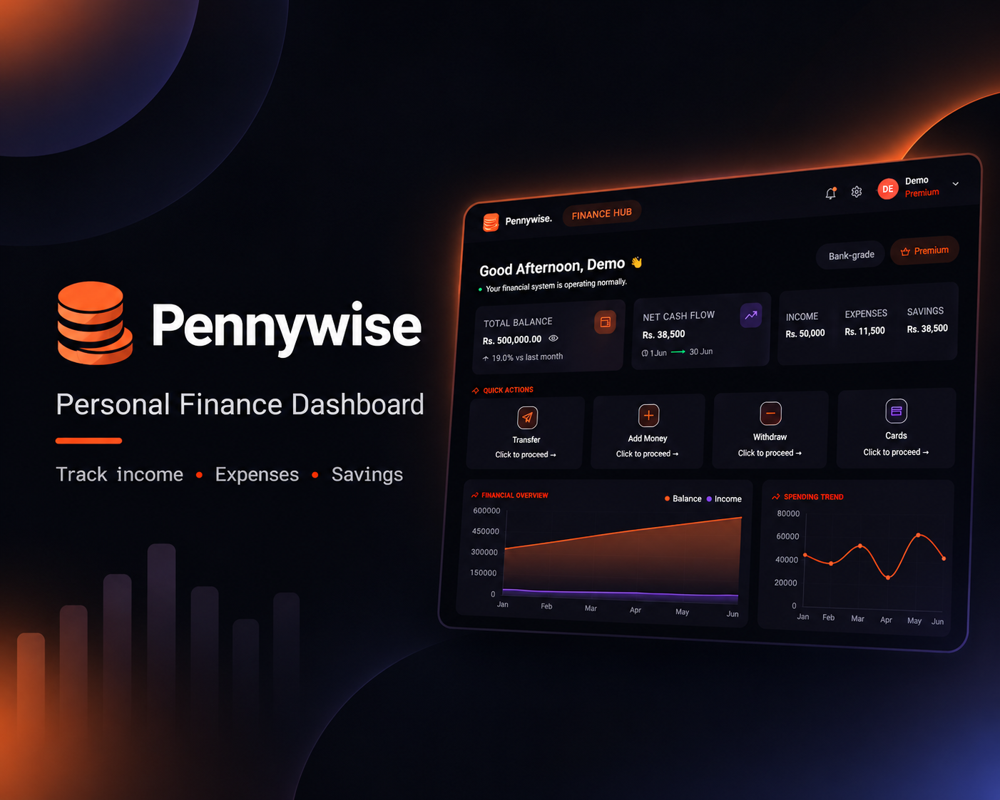
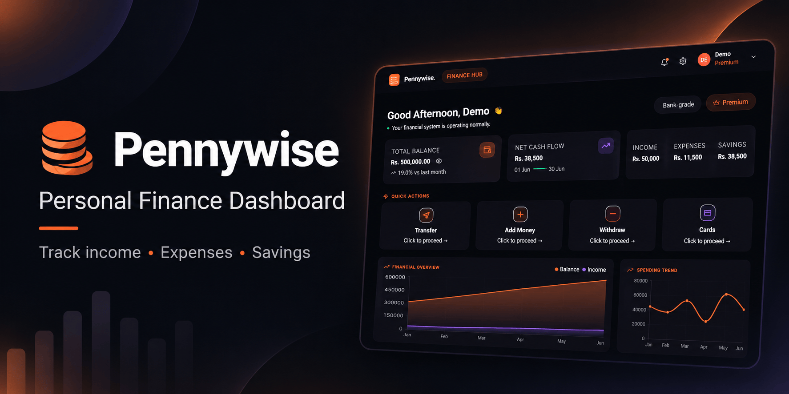
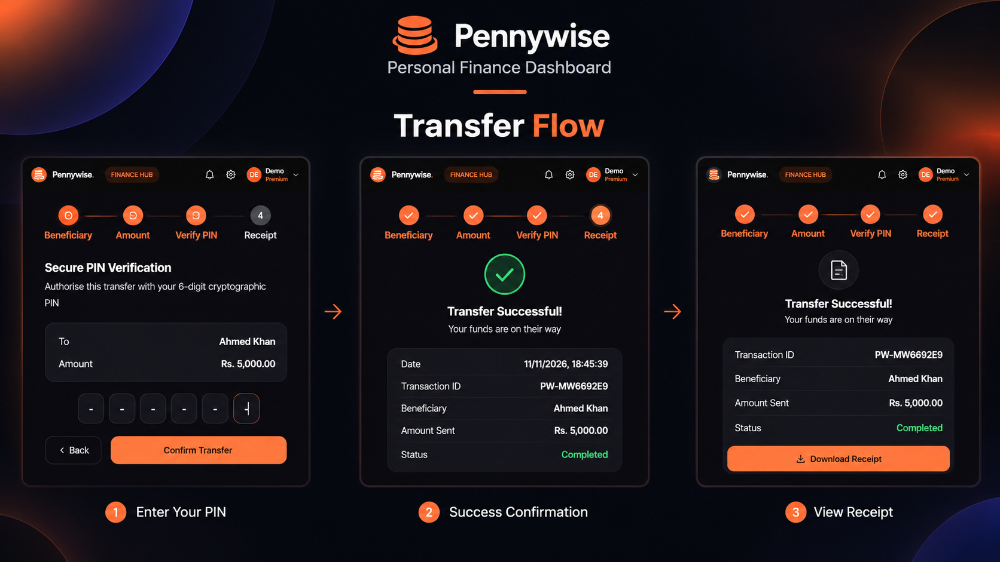

# Pennywise 💸
### Smart Personal Finance & Digital Banking Web Application

<p align="center">
  A modern, seamless, and intelligent personal finance experience designed around the needs of today's digital users.
</p>

<p align="center">
  <a href="https://pennywise-fintech-app.vercel.app/"><b>Live Demo</b></a> • 
  <a href="https://github.com/SanaHameed2/pennywise-fintech-app"><b>Repository</b></a> • 
  <a href="https://sana-portfolio-weld.vercel.app/"><b>Portfolio</b></a>
</p>

<p align="center">
  
  
  
  
  
  <a href="https://pennywise-fintech-app.vercel.app/"><b>Live Demo</b></a> • 
  <a href="https://github.com/SanaHameed2/pennywise-fintech-app"><b>Repository</b></a> • 
  <a href="https://sana-portfolio-weld.vercel.app/"><b>Portfolio</b></a>
</p>

<p align="center">
  
  
  
  
  
</p>

---

## 🎥 Project Showcase

[](https://www.youtube.com/watch?v=J4wbLWFqNXs)

*Click the image above to watch a 2-minute video walkthrough of the core features.*

---

## 🎥 Project Showcase

[](https://www.youtube.com/watch?v=J4wbLWFqNXs)

*Click the image above to watch a 2-minute video walkthrough of the core features.*

---

## 🚀 About Pennywise

Traditional banking experiences can often feel outdated, complicated, and disconnected from the needs of modern users.

**Pennywise** was created to address these challenges by bringing together personal finance management, digital banking workflows, financial insights, and accessibility in one modern web application.

Developed over six months of planning, implementation, debugging, and continuous refinement, Pennywise focuses on delivering an interface that doesn't just look premium but provides a smooth and intuitive financial experience.

The project explores modern fintech architecture through React, TypeScript, and Supabase, combining interactive frontend experiences with database-driven backend functionality.

---

## 📸 Screenshots

<div align="center">
  
  <p><i>Dashboard - Real-time financial overview and charts</i></p>
  
  
  <p><i>Secure Money Transfer Workflow with OTP</i></p>
</div>

---

---

## 📸 Screenshots

<div align="center">
  
  <p><i>Dashboard - Real-time financial overview and charts</i></p>
  
  
  <p><i>Secure Money Transfer Workflow with OTP</i></p>
</div>

---

## ✨ Core Features

### 💸 Secure Digital Transactions
- Guided money transfer workflows.
- Step-up OTP verification.
- Cryptographic PIN-based transaction verification.
- Additional authentication controls.
- Account security management.

### 🇵🇰 English & Urdu Localization
- Complete English and Urdu translation.
- Full Right-to-Left (RTL) layout support.
- Urdu Nastaliq typography.
- Localized interface and navigation.
- Accessibility-focused multilingual experience.

### 🔔 Real-Time Notifications
- Instant in-app transaction alerts.
- Supabase PostgreSQL database triggers.
- Supabase Realtime subscriptions.
- Database-driven notification workflows.

### 🎯 Smart Savings Goals
- Create and manage financial goals.
- Add contributions and manage withdrawals.
- Track savings progress.
- Visual financial goal analytics.

### 📈 Financial Analytics & Insights
- Dynamic financial dashboards.
- Income and expense tracking.
- Interactive charts and visualizations.
- Spending pattern analysis.
- Financial activity insights.

### 📱 Progressive Web Application (PWA)
- Installable application for desktop and mobile.
- Standalone app experience.
- Custom offline fallback page.
- Responsive user interface.

### 💳 Virtual Card Management
- Virtual card interfaces.
- Card locking and management controls.
- Spending limits.
- Card-related account settings.

---

## 🛠️ Technology Stack

| Category | Technologies |
|---|---|
| Frontend | React.js, TypeScript |
| Build Tool | Vite |
| Styling | Tailwind CSS |
| Backend & BaaS | Supabase |
| Database | PostgreSQL |
| Authentication | Supabase Auth |
| Database Security | Row Level Security (RLS) |
| Real-Time Services | Supabase Realtime |
| Data Visualization | Recharts |
| Animations | Framer Motion |
| Localization | i18next |
| PWA | Vite PWA |
| Deployment | Vercel |

## 🏗️ Application Architecture

Pennywise follows a modern frontend and backend integration approach.

**Frontend Layer**
- React component-based architecture.
- TypeScript for structured and type-safe development.
- Reusable UI components.
- Responsive layouts and interactive dashboards.
- Client-side routing and state management.

**Backend Layer**
- Supabase backend services.
- PostgreSQL relational database.
- Supabase Authentication.
- Row Level Security policies.
- Database triggers and functions.
- Realtime subscriptions.

**Security Layer**
- Authentication and session management.
- Step-up OTP verification.
- Cryptographic PIN verification.
- Database-level access control through RLS.

## ⚙️ Getting Started

### Prerequisites

Make sure you have the following installed:

- Node.js (LTS)
- npm
- A Supabase account

### 1. Clone the Repository

```bash
git clone https://github.com/SanaHameed2/pennywise-fintech-app.git