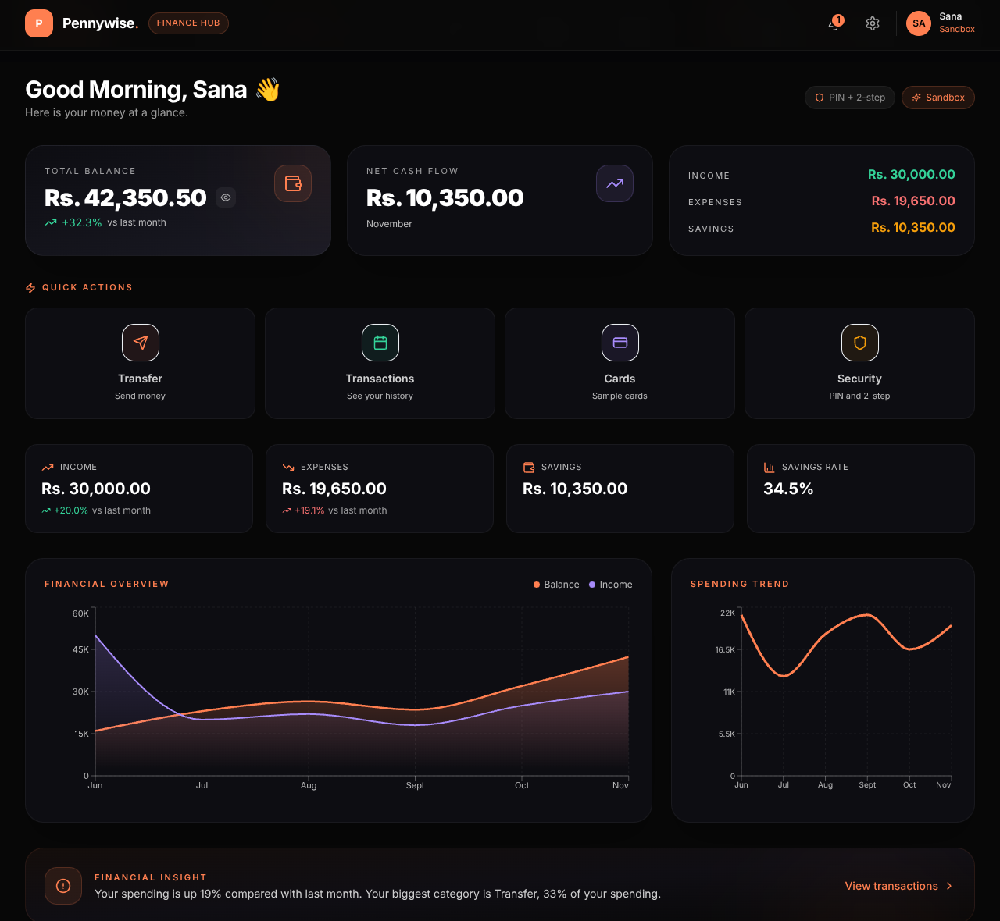
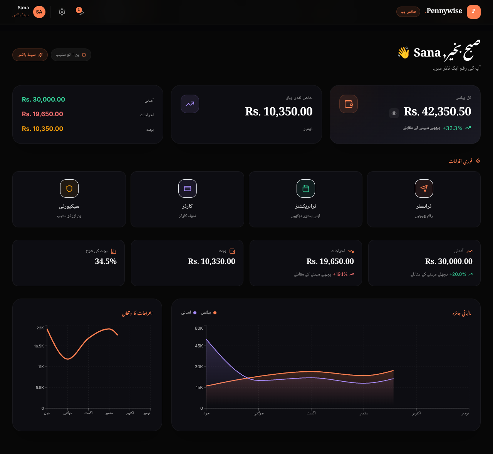
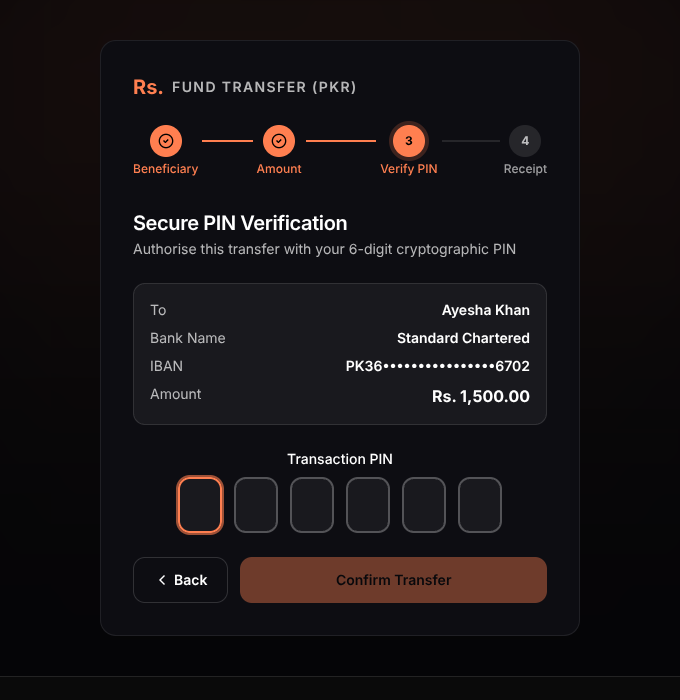
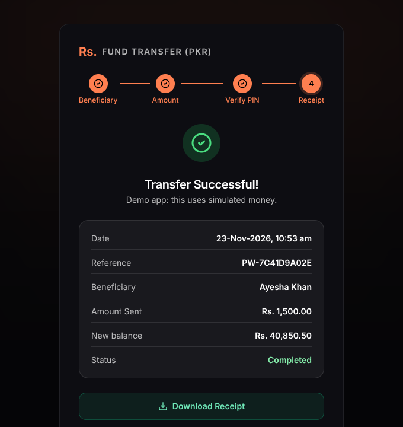

# Pennywise

> A sandbox digital wallet built to show how money features can be made **safe, clear and accessible**.
> All money is simulated. Pennywise is not a bank and cannot move real funds.

[Live demo](https://pennywise-fintech-app.vercel.app/) · [Portfolio](https://sana-portfolio-weld.vercel.app/) · [Walkthrough video](https://www.youtube.com/watch?v=J4wbLWFqNXs) · [Security model](docs/SECURITY.md)


| Dashboard (real data from the ledger) | Urdu, right-to-left |
|---|---|
|  |  |

| PIN confirmation | Server-confirmed receipt |
|---|---|
|  |  |

*Screenshots use sample data from a test backend.*

## What it does

- **Send money safely.** Pick a saved beneficiary (IBAN check digits are verified), enter an amount, confirm with a **transaction PIN**; transfers of Rs. 10,000+ also need a fresh **authenticator-app code**. A receipt with a server-issued reference follows. A failure never shows a receipt.
- **Real insights.** Monthly income, spending, closing balance and categories are computed from your own transactions on the server.
- **Savings goals**, **transaction history** with filters and CSV export, **notifications**, **sample virtual cards**.
- **English and Urdu**, fully right-to-left, with the browser language (including `ur-PK`) detected.
- **Accessible by design:** skip link, landmarks, labelled controls, announced step changes and errors, text alternatives for charts, AA colour contrast. Checked automatically on every change (see below).
- **Installable PWA.** One-click **demo wallet** (private, throw-away session, no shared credentials).

## How money is kept safe

Everything that moves money lives in PostgreSQL functions, not in the browser:

| Concern | Mechanism |
|---|---|
| Browser can't edit balances | No write access to wallets/transactions; only `SECURITY DEFINER` RPCs write |
| No double charges | Per-attempt idempotency key; a retry returns the original result |
| Concurrent requests | Row lock on the wallet; two parallel 30,000 transfers on a 50,000 wallet: exactly one succeeds |
| Stolen session | PIN (bcrypt hash, 5 tries then 15-min lock) + TOTP freshness read from the signed JWT |
| Limits | Rs. 50,000 per transfer, Rs. 100,000 per day (Asia/Karachi) |
| Data isolation | Row-level security on every table |
| Audit | Every success **and failure** is recorded |

The full audit that led to this design (8 exploitable holes found in the earlier version, each reproduced and then proven closed) is in [docs/SECURITY.md](docs/SECURITY.md).

## Verified, not just claimed

| Suite | What it proves | Command |
|---|---|---|
| **Database** (real PostgreSQL) | 72 checks: every historical exploit is blocked; PIN lock-out, MFA freshness, limits, idempotency, concurrency, signup, insights, guest cleanup, ledger always balances | `npm run test:db` |
| **Unit / component** (Vitest) | Wizard never shows success on failure (mutation-checked), translations complete and consistent, PIN input, settings, a11y with axe | `npm test` |
| **End-to-end** (Playwright, real Chromium, mocked backend) | Full transfer flow with keyboard, focus management, Urdu RTL, axe (WCAG 2.2 AA incl. contrast) on every page in both languages | `npm run test:e2e` |
| **Static** | ESLint incl. `jsx-a11y`, strict TypeScript | `npm run verify` |

CI runs all of it (`.github/workflows/ci.yml`).

## Run it

```bash
git clone https://github.com/SanaHameed2/pennywise-fintech-app.git
cd pennywise-fintech-app
npm ci
cp .env.example .env        # add your Supabase URL + anon key
npm run dev
```

Set up the database by applying `supabase/migrations/` in order (`supabase db push`, or paste them into the SQL editor).
Then enable **Authentication → Providers → Allow anonymous sign-ins** (for the one-click demo) and optionally schedule the nightly guest clean-up described in the last migration. Step-by-step notes are in [docs/HANDOVER.md](docs/HANDOVER.md).

## Project layout

```
src/app/pages        route pages (Home, Dashboard, TransferWizard, Settings via features/)
src/hooks            data + security hooks (transfer, PIN, step-up MFA, insights)
src/lib              Supabase client, typed RPC results, i18n, limits
src/locales          en.json / ur.json (kept in lockstep by a test)
supabase/migrations  schema, RLS, money RPCs, insights, guest sessions
supabase/tests       PostgreSQL security & behaviour suite
tests/e2e            Playwright specs + fake Supabase backend
```

## Honest limitations

- Money is simulated; there is no payment-provider integration.
- "Cards" are sample cards (not stored). Transaction descriptions written by the server are in English.
- Manual testing with screen readers (NVDA, VoiceOver, TalkBack) is ongoing; automated checks cannot replace it.

## License

No license has been chosen yet, so all rights are reserved by default. Add a `LICENSE` file if you want others to reuse the code.
